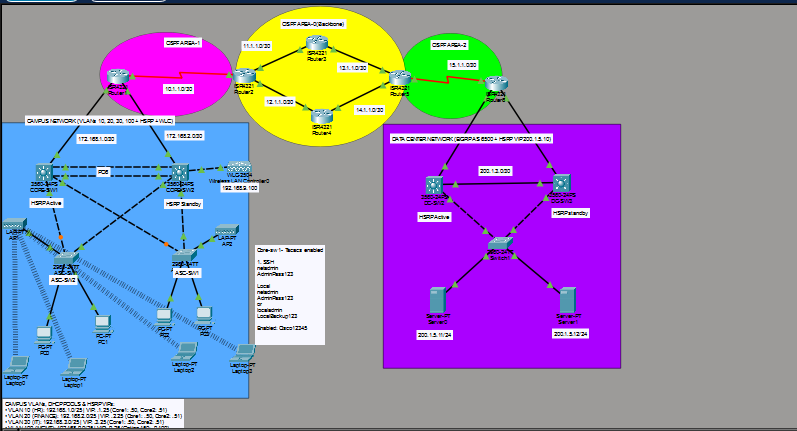

# Lab 01: Enterprise Campus, WAN and Data Center

A three-tier enterprise network built in Cisco Packet Tracer: a redundant campus core, a multi-area OSPF backbone with dual equal-cost paths, a data center running EIGRP, and a wireless/AAA layer.

## Architecture

- **Campus:** access switches connect endpoint VLANs to two Layer 3 Catalyst 3560 distribution cores (CORE-SW1, CORE-SW2) running HSRP, with a 2 x 1 Gbps LACP Port-Channel 6 between them.
- **WAN backbone:** campus traffic enters OSPF Area 1 at Router1, crosses OSPF Area 0 over two equal-cost paths (Router3 and Router4), and reaches OSPF Area 2 at Router5.
- **Data center:** Router6 is the ASBR and mutually redistributes OSPF and EIGRP AS 100 into two redundant data center core switches (DC-SW2, DC-SW3) running HSRP.
- **Wireless and security:** Cisco WLC 2504 with SSID CAMPUS-WIFI mapped to VLAN 30, lightweight APs joining by DHCP option 150, and a TACACS+ AAA server in the data center.

## Technologies

HSRP (active/standby with preempt), LACP 802.3ad EtherChannel, 802.1Q trunking, inter-VLAN routing (SVIs), OSPF (Areas 0, 1, 2, ABRs, ASBR), EIGRP AS 100, route redistribution, centralized DHCP (including option 150), DNS, TACACS+ AAA, Cisco WLC and CAPWAP.

## Design highlights

| Area | Design |
|------|--------|
| Campus gateway | HSRP on VLANs 10, 20, 30 and 100. CORE-SW1 is Active (priority 250), CORE-SW2 is Standby (priority 100), both with preempt |
| Inter-core link | LACP Port-Channel 6 on Gi0/1 - 2 carrying VLANs 10, 20, 30, 99, 100 |
| Campus routing | OSPF Area 1 between CORE-SW1, CORE-SW2 and Router1 |
| Backbone | Router2 (Area 1/0 ABR), Router3 and Router4 (Area 0), Router5 (Area 0/2 ABR) |
| Data center edge | Router6 (ASBR) redistributes between OSPF 1 and EIGRP 100 |
| Data center gateway | HSRP VIP 200.1.5.10 on VLAN 50. DC-SW2 priority 110, DC-SW3 priority 100 |
| DHCP | Centralized scopes on CORE-SW1 for VLANs 10, 20, 30 and 100 |
| Wireless | WLC-2504 on VLAN 100 management; dynamic interface for VLAN 30 |
| AAA | TACACS+ on Server0 (200.1.5.11) for switch administration |

## Verification

| Scope | Command | Expected result |
|-------|---------|-----------------|
| Campus HSRP | `show standby brief` on CORE-SW1 | VLANs 10, 20, 30, 100 Active (priority 250) |
| HSRP failover | shut CORE-SW1 SVIs | CORE-SW2 becomes Active; ping drops 2 packets or fewer |
| EtherChannel | `show etherchannel summary` | Po6 (SU) with Gi0/1 (P) and Gi0/2 (P) |
| OSPF adjacencies | `show ip ospf neighbor` on Router1 | CORE-SW1, CORE-SW2 and Router2 in FULL state |
| Redistribution | `show ip route ospf` on Router1 | 200.1.5.0/24 present as O E2 |
| Data center gateway | `show standby brief` on DC-SW2 | VLAN 50 Active for VIP 200.1.5.10 |
| End to end | `ping 200.1.5.11` from Laptop0 | 0% loss, round trip under 35 ms |

Screenshots of the command outputs go in [docs/evidence](docs/evidence).

## Repository contents

| Path | Contents |
|------|----------|
| `Enterprise_Network_Implementation.pkt` | Packet Tracer lab file |
| `topology.png` | Topology screenshot |
| `configs/` | Device configurations (one file per device) |
| `configs/servers.md` | Server0 (TACACS+, DNS) and Server1 setup |
| `configs/wlc-and-wireless.md` | WLC-2504 provisioning and wireless client setup |
| `docs/ip-addressing.md` | Full interface and subnet inventory |
| `docs/troubleshooting.md` | Common faults and fixes |
| `docs/evidence/` | Verification screenshots |

## How to open the lab

Open `Enterprise_Network_Implementation.pkt` in Cisco Packet Tracer. The devices already hold their configurations.
